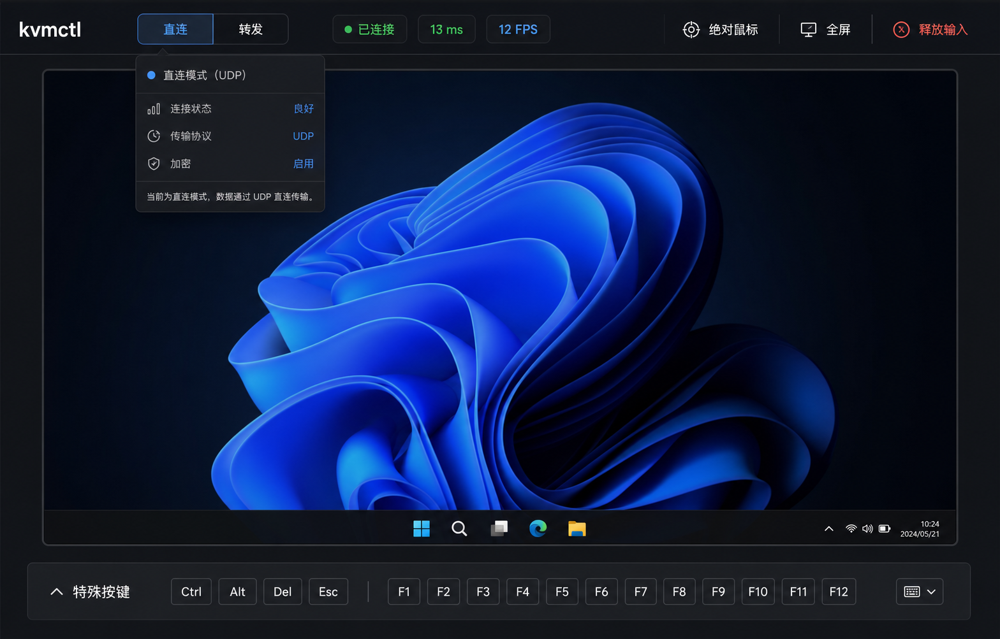

# 浏览器控制界面设计方向

本设计稿由图像生成能力产出，用于约束正式 HTML/CSS 的视觉层级，不作为运行时位图资产。

- 被控画面占据页面主体，工具不覆盖关键画面区域。
- 顶部紧凑呈现 `直连 / 转发` 选择、连接状态、RTT、实际 FPS、鼠标模式、全屏和释放输入。
- 直连详情按需展开；常态只显示候选类型和性能，不显示地址。
- 特殊按键收纳到底部可折叠托盘，在 BIOS/UEFI 场景中仍能快速触达。
- 深色中性界面使用蓝色表示活动选择、绿色表示健康、琥珀色表示等待或警告、红色仅表示释放输入等安全动作。
- 首版以功能完整和响应式布局为准，不复制设计稿中的操作系统画面或装饰细节。
